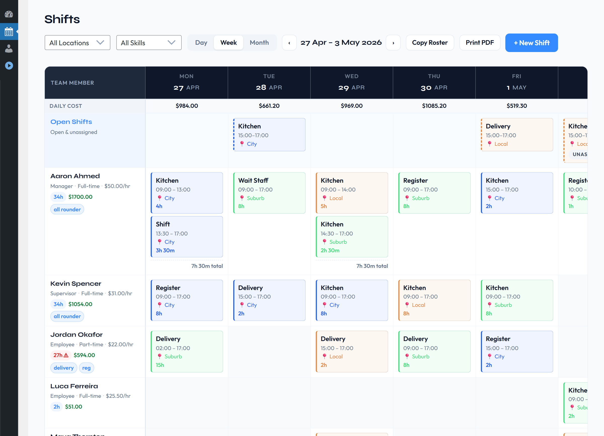
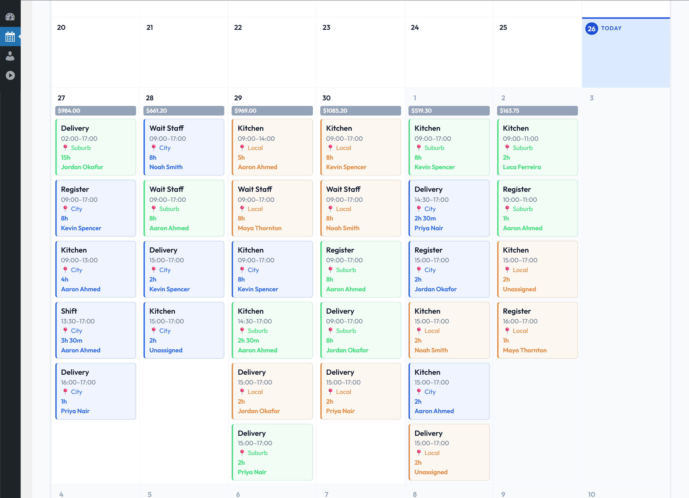
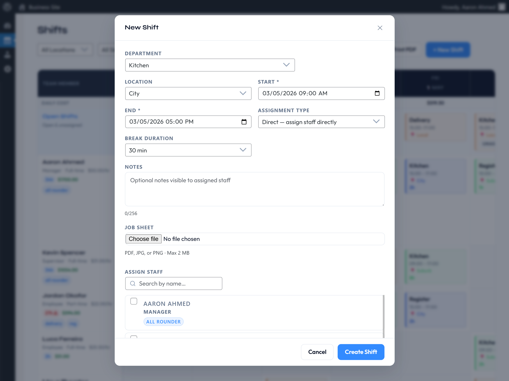
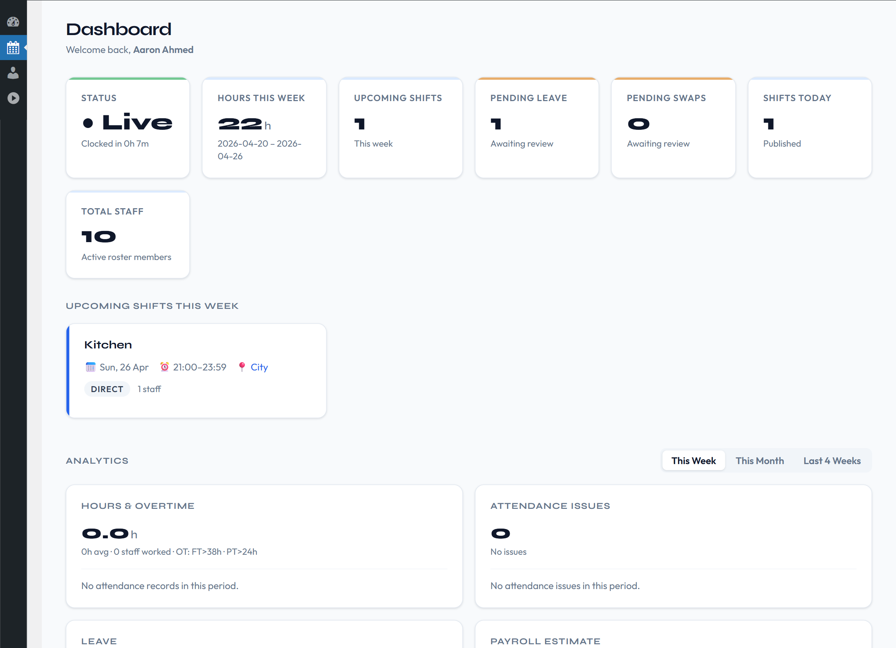
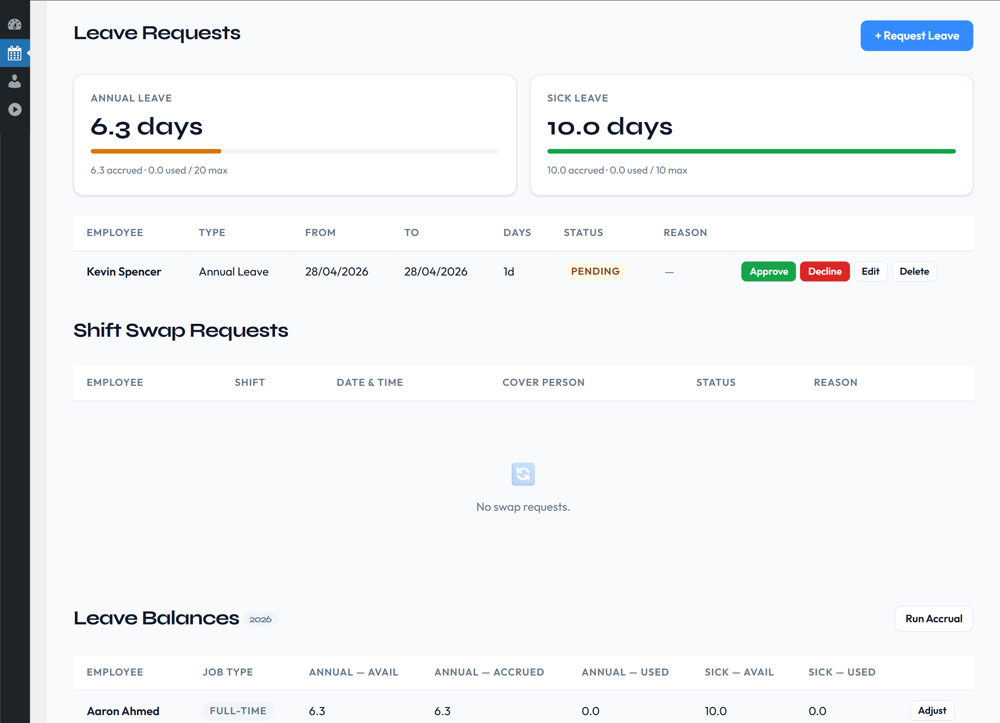
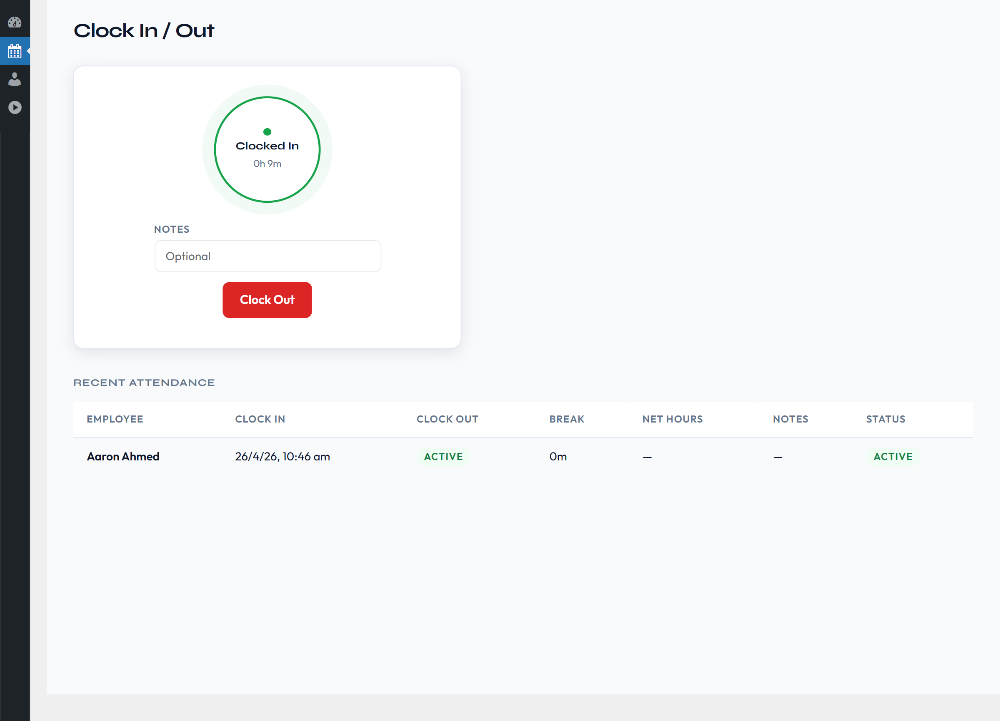

<p align="center">
  
</p>

<h1 align="center">Employee Roster</h1>

<p align="center">
  <strong>WordPress shift scheduling &amp; staff rostering. Self-hosted, no SaaS fees, no per-user costs.</strong>
</p>

<p align="center">
  
  
  
  <a href="https://wordpress.org/plugins/employee-roster/"></a>
</p>

---

Schedule shifts, track attendance, manage leave, and run payroll without ever leaving WP Admin.

Employee Roster is a complete staff rostering system that runs on your own WordPress install. There
are no external APIs to sign up for, no third-party accounts, and no monthly per-seat costs. Every
shift, timesheet, and leave record stays in your own database.

- 🔒 **Self-hosted.** Your data never leaves your server.
- ⚡ **No external APIs.** Nothing to depend on, nothing to go down.
- 👥 **Unlimited employees** on every plan, including the free version.
- 🧩 **Frontend portal.** Staff never need to see WP Admin if you'd rather they didn't.

**[Documentation](https://employeeroster.io/docs)** ·
**[Website](https://employeeroster.io/)** ·
**[Blog](https://employeeroster.io/blog/)** ·
**[Free download](https://wordpress.org/plugins/employee-roster/)**

---

## Screenshots

| | |
|---|---|
|  <br> **Weekly roster** |  <br> **Monthly calendar** |
|  <br> **Creating a shift** |  <br> **Manager dashboard** |
|  <br> **Leave requests** |  <br> **Clock in / clock out** |

---

## Features

Anything marked `Starter+` or `Professional+` needs a paid licence. Everything else ships in the free
WordPress.org build. The full matrix is over in [Plans](#plans--pricing).

### Shift scheduling

- Create shifts with **direct assignment**, or post them as **open slots** staff claim themselves
- Day, week, and month roster views
- **Open Shifts.** Employees self-assign up to the slot limit, with optional manager approval `Starter+`
- **Copy Roster.** Rebuild next week from an existing week in a single action `Starter+`
- Edit and delete shifts, with automatic notification whenever timings change
- No cap on the number of active shifts, on any plan

### Attendance & time tracking

- Clock in and out from WP Admin or the frontend portal `Starter+`
- Break deductions and shift linking
- One active session per user, enforced
- Managers can edit or correct any attendance record `Starter+`
- An optional self-clock setting so you decide who may clock themselves in `Starter+`

### Leave & requests

- Annual and sick leave requests with a manager approval workflow `Starter+`
- **Leave balances.** Entitlements accrue automatically per job type through the year, and you can
  adjust them by hand whenever you need to `Starter+`
- **Shift swap requests.** Employees nominate an optional target and a reason, and assignments
  update themselves once approved `Professional+`
- **Open shift requests.** Approve or decline claims on open slots `Starter+`

### Timesheets & payroll

- Weekly timesheet summaries with hours worked
- Pay rate calculations and earnings `Starter+`
- **Weekend penalty rates.** Saturday (25% by default) and Sunday (50% by default) multipliers get
  applied for you `Starter+`
- Tax calculation with a configurable rate `Professional+`
- **Daily labour budget** with per-day targets `Professional+`
- Weekly hour limits per job type: 38h full-time, 24h part-time, unlimited casual. The limits are
  configurable on every plan, though over-limit warnings are `Starter+`

### Staff availability

- Weekly recurring availability, with day-level time ranges
- Availability hints (`Available`, `Unavailable`, `Not Set`) shown inline in the shift assignment
  modal, so you can see who's free while you're assigning

### Staff management

- Add and edit staff, with a full onboarding welcome email `Starter+`. The free build sends a
  simplified welcome without credentials.
- **Skill tags** such as Barista, First Aid, or Forklift Licence, shown on profiles, in the
  assignment modal, and as a roster filter `Professional+`
- **Deactivation.** Hides someone from the roster, revokes frontend access, and cancels pending
  leave and swap requests. Reactivating them sends a fresh welcome email.
- **Job sheet attachments.** PDF, JPG, or PNG up to 2 MB per shift `Professional+`

### Dashboard, analytics & exports

- Analytics dashboard `Starter+`
- Employees can export their own timesheet to CSV (free, and done client-side)
- Staff directory and team timesheet CSV export `Starter+`
- **Print roster.** A colour-coded, print-ready roster straight from the manager toolbar via the
  browser print dialog, which is also where you'd print to PDF `Professional+`

### Email notifications

Plain-text emails sent through `wp_mail()`, available on **every** version including free:

- Welcome email for new accounts
- Shift assignment email
- Shift timing change email
- Leave decision email (approved or rejected)

### Frontend employee portal

Five shortcode-driven pages get created automatically on activation, so staff can work entirely
outside WP Admin. See [Shortcodes](#shortcodes).

---

### Roles & access

- Three custom roles: Roster Manager, Roster Supervisor, and Roster Employee
- Per-administrator visibility control and admin inclusion settings
- Roster users only see the EmpRoster menu. Other menus, dashboard widgets, and plugin notices stay
  hidden, and they land on the EmpRoster dashboard when they log in.
- **Profile Mode** blocks employee and supervisor WordPress logins entirely while keeping email
  notifications running `Starter+`

### Security

- **Employee login logs** capture successful logins, logouts, and failed attempts, along with IP
  address and device detection. Filter by event type, date, or staff member, and set your own
  auto-delete retention `Professional+`. Off by default.

---

## Requirements

| Component | Requirement |
|---|---|
| WordPress | 5.8 or later (tested up to 7.0) |
| PHP | 7.4 or later |
| MySQL / MariaDB | No plugin-specific minimum. Whatever your WordPress version requires. |
| External services | None. All data is stored in your own WordPress database. |

> The free and premium versions have identical requirements, so upgrading to a paid plan won't ask
> you for a newer version of WordPress or PHP.

---

## Installation

1. Upload the `emp-roster` folder to `/wp-content/plugins/`, or install the ZIP through
   **Plugins → Add New → Upload Plugin**.
2. Activate the plugin via **Plugins → Installed Plugins**.
3. On activation the plugin automatically:
   - Creates **8 custom database tables**: `shifts`, `assignments`, `leave`, `attendance`,
     `availability`, `swap_requests`, `leave_balances`, and `login_logs`
   - Registers the roster roles `emr_manager`, `emr_supervisor`, and `emr_employee` on paid plans.
     The free WordPress.org build registers `emr_employee` only.
   - Seeds default settings, one department (**General Department**) and one location
     (**Main Location**)
   - Creates 5 WordPress pages pre-loaded with the frontend portal shortcodes
4. The **setup wizard** opens by itself the first time an administrator visits an EmpRoster screen.
   It covers company details, locations, departments, employment types, leave, and the key features.
   You can re-run it any time from **EmpRoster → Settings → Setup Wizard**.
5. Add your staff at **EmpRoster → Staff → + Add Staff**, then create your first shift at
   **EmpRoster → Shifts → + New Shift**.

---

## Shortcodes

The five portal pages are created for you on activation, and their addresses are listed under
**Settings → Frontend Pages**. The free build registers 3 shortcodes; premium registers 5.

| Page | Shortcode | Plan | Purpose |
|---|---|---|---|
| EmpRoster – Dashboard | `[empr_dashboard]` | Free | Upcoming shifts and hours at a glance |
| EmpRoster – My Shifts | `[empr_shifts]` | Free | Their roster for the week |
| EmpRoster – Availability | `[empr_availability]` | Free | Set the days and hours they can work |
| EmpRoster – Leave | `[empr_leave]` | `Starter+` | Submit leave and track requests |
| EmpRoster – Clock In/Out | `[empr_attendance]` | `Starter+` | Clock in and out, and view history |

### Public roster `Professional+`

Embed a read-only, print-friendly weekly roster on any public page, with no login required. Turn it
on first at **EmpRoster → Settings → Integrations & Public View → Weekly Roster Shortcode**, then:

```
[emp_roster_weekly]
[emp_roster_weekly week="2026-08-03"]
```

The `week` attribute takes any date inside the week you want to display. Leave it off and you get
the current week.

---

## Roles & capabilities

| Role slug | Display name | Access |
|---|---|---|
| `emr_manager` | **Roster Manager** | Full roster management: create, edit and delete shifts, assign staff, manage staff accounts, approve leave and requests, edit attendance, manage settings, view payroll |
| `emr_supervisor` | **Roster Supervisor** | A read-only elevated role. Sees the whole roster, all staff, attendance and analytics, and can submit their own leave, swap and open-shift requests, but can't create shifts, assign people, or approve anything |
| `emr_employee` | **Roster Employee** | View own shifts, clock in and out, submit leave, set availability, claim open shifts |

### Capabilities

| Capability | Granted to |
|---|---|
| `emr_view_own_shifts` | All roles |
| `emr_clock_in_out` | All roles |
| `emr_submit_leave` | All roles |
| `emr_manage_availability` | All roles |
| `emr_request_swap` | All roles |
| `emr_view_all_staff` | Manager, Supervisor, Admin |
| `emr_view_all_shifts` | Manager, Supervisor, Admin |
| `emr_view_reports` | Manager, Supervisor, Admin |
| `emr_manage_shifts` | Manager, Admin |
| `emr_approve_leave` | Manager, Admin |
| `emr_edit_attendance` | Manager, Admin |
| `emr_manage_settings` | Manager, Admin |

**Worth knowing:**

- Capabilities are independent of plan gating. A capability grants access to a screen; the plan
  decides whether the feature behind it is even present.
- Only a WordPress administrator can create, promote, demote or deactivate a Manager account, or
  reset a manager's password.
- Nobody can change their own role.

---

## Plans & pricing

Annual, per-site licences. One payment a year, and no per-user fees, ever. Every paid plan comes
with a **14-day free trial, no credit card required**.

| | **Free** | **Starter** | **Professional** | **Business** |
|---|---|---|---|---|
| Price | $0 | $99/yr | $199/yr | $599/yr |
| Sites | Unlimited | 1 | 1 | 5 |
| Shifts, departments, locations, employees | Unlimited | Unlimited | Unlimited | Unlimited |
| Day / week / month roster views | ✅ | ✅ | ✅ | ✅ |
| Staff availability & hints | ✅ | ✅ | ✅ | ✅ |
| Email notifications | ✅ | ✅ | ✅ | ✅ |
| Staff deactivation & reactivation | ✅ | ✅ | ✅ | ✅ |
| Manager & Supervisor roles | ❌ | Supervisor only | ✅ | ✅ |
| Open shifts & copy roster | ❌ | ✅ | ✅ | ✅ |
| Clock in / out & attendance management | ❌ | ✅ | ✅ | ✅ |
| Leave requests, approval & balances | ❌ | ✅ | ✅ | ✅ |
| Payroll & weekend penalty rates | ❌ | ✅ | ✅ | ✅ |
| Analytics dashboard | ❌ | ✅ | ✅ | ✅ |
| Staff & team CSV export | ❌ | ✅ | ✅ | ✅ |
| Profile Mode | ❌ | ✅ | ✅ | ✅ |
| Shift swap requests | ❌ | ❌ | ✅ | ✅ |
| Skill tags | ❌ | ❌ | ✅ | ✅ |
| Tax & daily labour budget | ❌ | ❌ | ✅ | ✅ |
| Supervisor pay-rate visibility | ❌ | ❌ | ✅ | ✅ |
| Job sheet attachments | ❌ | ❌ | ✅ | ✅ |
| Public roster shortcode | ❌ | ❌ | ✅ | ✅ |
| Employee login logs | ❌ | ❌ | ✅ | ✅ |
| Print roster | ❌ | ❌ | ✅ | ✅ |
| Support | Community forum | Email (72 hr) | Email (24 hr) | Priority (same day) |
| Updates | Security only | 1 year | 1 year | 1 year |

> **Business and Professional include the same features.** Business simply covers more sites per
> licence, 5 instead of 1. There's no Business-only functionality.

### Staff account limits

| Role | Free | Starter | Professional | Business |
|---|---|---|---|---|
| Roster Employee | Unlimited | Unlimited | Unlimited | Unlimited |
| Roster Supervisor | Role not registered | 2 | Unlimited | Unlimited |
| Roster Manager | Role not registered | Not assignable, use Admin Visibility instead | Unlimited | Unlimited |

Existing staff are kept if you downgrade, and managers created while you were on Professional keep
the role even if the site later drops to Starter.

**Buy:** [Starter](https://checkout.freemius.com/plugin/28057/plan/46315/) ·
[Professional](https://checkout.freemius.com/plugin/28057/plan/46316/) ·
[Business](https://checkout.freemius.com/plugin/28057/plan/46317/) ·
[Start a free Professional trial](https://checkout.freemius.com/plugin/28057/plan/46316/?trial=free)

---

## Developer notes

- **Tables** are created with the site's `$wpdb` prefix followed by `emr_` (8 of them, listed under
  [Installation](#installation)).
- **No outbound HTTP.** The plugin calls no external APIs, and all data stays in the WordPress
  database. Email goes through `wp_mail()`, so it uses whatever mailer the site already has.
- **Free and premium builds are physically different ZIPs.** Premium code is absent from the
  WordPress.org build rather than gated at runtime, so "not in free" means genuinely not shipped.

---

## Support & links

- 📖 Documentation: <https://employeeroster.io/docs>
- ✉️ Support: <support@employeeroster.io>
- 🌐 Website: <https://employeeroster.io/>
- ✍️ Blog: <https://employeeroster.io/blog/>
- ⬇️ Free download: <https://wordpress.org/plugins/employee-roster/>
- 🔐 [Privacy Policy](https://employeeroster.io/privacy) · [Terms](https://employeeroster.io/terms)

---

## License

Released under the **GNU General Public License v3.0**. See [LICENSE](LICENSE) for the full text.

Employee Roster is an independent WordPress plugin.
